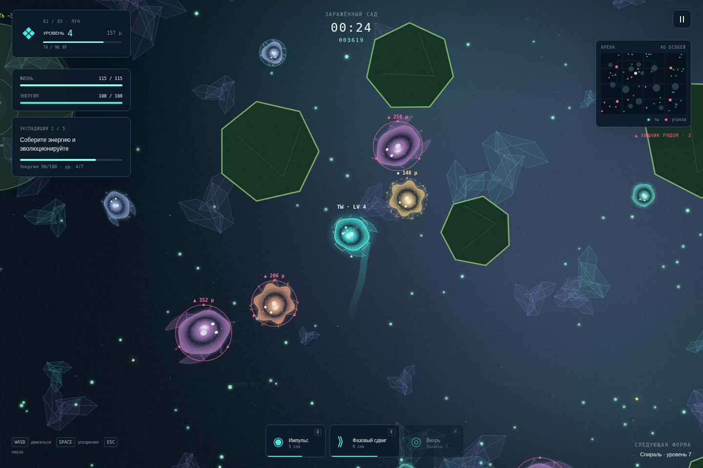
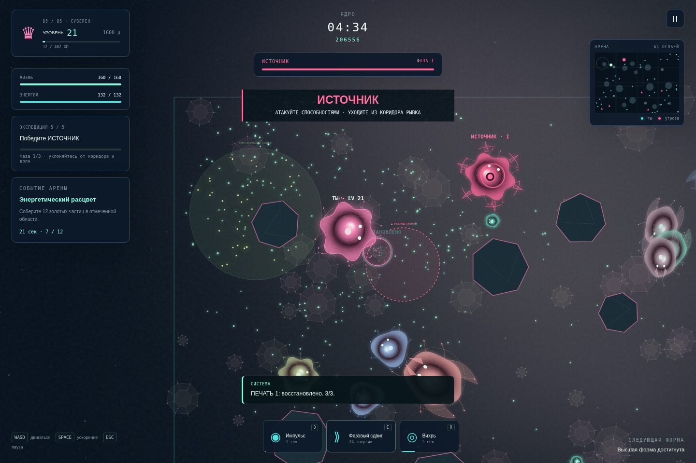

# NEON EVOLUTION · 3.0 «Экспедиция NE-002»

Браузерный аркадный симулятор роста с сюжетной экспедицией, выживанием и бесконечной охотой. HTML, CSS и обычный JavaScript; процедурная графика Canvas 2D и звуки Web Audio. Игра работает без сборщика, backend, CDN и внешних игровых ассетов.

## Запуск

Скачайте архив, распакуйте целиком и откройте **index.html** в современном браузере. Все файлы `js/` и `styles.css` должны остаться рядом с ним. Интернет для игры не требуется.

Если браузер запрещает локальные страницы, откройте папку через любой статический сервер. Например:

```sh
cd arcadsimrost
python3 -m http.server 8080
```

Откройте адрес этого сервера в браузере. Для устойчивого сохранения используйте один браузер и один адрес страницы. Разные адреса, `file://` и HTTP могут иметь отдельный localStorage.

## Начать экспедицию

**Главное меню → Экспедиция → Колыбель → Брифинг → Начать миссию.** Игрок — NE-002, восстановительный организм, пробудившийся в разрушенной исследовательской системе. Неизвестный оператор помогает восстановить сеть и происхождение собственной памяти. Короткие сообщения сопровождают действия; сюжет не останавливает игру. Подробные найденные записи доступны из карты.

Последовательность каждой миссии: освоиться и эволюционировать → исследовать отмеченные объекты → выполнить задачу → пройти финальное испытание → **дойти до открытого шлюза**. Выполнение счётчиков или убийство сюжетного босса само по себе не завершает миссию. HUD показывает этап, прогресс и состояние защищаемой системы; мини-карта и стрелка помогают найти следующую цель.

| Сектор | Основная задача | Особенность / испытание |
| --- | --- | --- |
| Колыбель | 60 частиц, уровень 4; зарядить три реле по 6 с | Начальные хищники слабее, 12 с защиты; обломки капсул; защита запуска шлюза 45 с |
| Заражённый сад | 100 частиц, уровень 7; разрушить четыре очага и очистить каждый 40 с | Очаги рождают рой, споры замедляют на 35%; очищенные зоны безопасны; Матка с тремя фазами |
| Осколочный пояс | 100 частиц, уровень 7; загрузить пять фрагментов по 18 с | Твёрдые осколки; циклические разряды с предупреждением 3 с; передача памяти и защита ретранслятора 65 с |
| Затопленный реактор | 120 частиц, уровень 7; включить четыре узла по 25 с | Течения сносят игрока и врагов; перезапуск и защита реактора 130 с |
| Ядро | 160 частиц, уровень 10; снять три печати по 40 с | Поля разрядов, крупные охотники; Источник с рывками, стаями, снарядами и волнами в трёх фазах |

Объект заряжается автоматически, пока вы рядом: отдельная клавиша взаимодействия не нужна. Загрузка расходует 4 энергии/с и прерывается при ударе; её частичный прогресс остаётся в текущей попытке. Оболочки очагов повреждаются **Q, E, R и контактом**. После разрушения нужно остаться у очага для очистки. Загрузка памяти при разряде приостанавливается; ждите безопасного окна. Пунктир предупреждает, розовое заполнение показывает активный разряд.

У защищаемой системы есть собственная прочность. Перезапуск и ремонт идут, пока игрок в пределах 370 м; первые волны начинаются после прибытия. Диверсанты сознательно идут к системе. Импульс отбрасывает их, близость ремонтирует, броня и регенерация усиливают ремонт. Если система разрушена, попытка проиграна, даже если организм жив. Прогресс перезапуска при отходе приостанавливается, атаки продолжаются.

У боссов рывок отмечен коридором, круговая атака — лучами за секунду до выстрелов. Фазы различаются цветом, помощниками и волнами. Сюжетный босс не может пропустить фазу от большого урона: на пороге временный бирюзовый щит показывает перестройку. Уклоняйтесь, затем продолжайте бой. После победы путь до шлюза остаётся частью миссии.

Колыбель рассчитана на короткое обучение, ориентир 3–5 минут; обычные сектора — 6–10 минут. Это ориентиры для ручного прохождения, а не таймеры победы. Быстрый опытный игрок может пройти раньше. Баланс проверяется автоматическим игроком; длительность и сложность для людей требуют дальнейшего игрового тестирования.

## Постоянный прогресс

После первого выхода сектора выдаются **4 / 5 / 6 / 7 / 9 образцов ⬡**, кристаллы, опыт профиля, звёзды и доступ к следующей карте. Повторный выход даёт 1 / 2 / 2 / 3 / 3 образца по сектору и обычные награды профиля. Звёзды: победа; минимум 50% жизни **при эвакуации**; порог очков, указанный на карте. Первые призы и награды новых звёзд выдаются однократно.

**Карта → Постоянные гены:** четыре направления по три ранга, цены 3 / 5 / 8 образцов. Бонусы применяются со старта следующей миссии и действуют только в экспедиции:

- Маршрутная память: +3,5% скорости за ранг.
- Резонансная память: +5% наносимого урона за ранг.
- Защитная память: +8 жизни организма и +10 прочности защищаемой системы за ранг.
- Память ассимиляции: +3% массы и опыта за ранг.

Найденные записи и открытые формы сохраняются **сразу**, включая поражение. Открытые сектора и постоянные гены не теряются. После смерти можно повторить тот же сектор. Образцы выдаются за успешную эвакуацию. Экран итога объясняет награду, новые записи и следующий маршрут. Незавершённая попытка после закрытия страницы начинается заново.

Вне кампании остаются профиль до уровня 50, шесть локальных лиг, 12 косметических скинов, 15 призов за общий опыт, три ежедневных контракта, достижения и отдельные рекорды режимов. Это локальный прогресс, без сетевого рейтинга или облачной синхронизации. Все скины косметические.

## Рост и бой

Собирайте светящуюся энергию, поглощайте мелкую добычу, избегайте крупных хищников. Рост увеличивает силу и уменьшает скорость. Чтобы поглотить живое существо, будьте массивнее на **18%**. Бирюзовое кольцо и ● — добыча; жёлтый ◆ — равный; розовый ▲ — опасность. Значки одинаковы во всех цветовых атмосферах.

Пять стадий организма открываются на уровнях 1 / 4 / 7 / 10 / 13. Достигнутую форму можно выбрать для следующего старта: это небольшой бонус, новая попытка начинается с первой стадии и 18 массы. На каждом уровне выбирайте один из 15 работающих генов: скорость, сбор, рост, опыт, запас/восстановление энергии, броня, жизнь, лечение, урон, перезарядка, ускорение и усиления трёх способностей. В экспедиции предложения выбираются из разных ролей, брифинг поясняет полезные направления.

| Способность | Открытие | Энергия / перезарядка | Действие |
| --- | --- | --- | --- |
| Q · Импульс | Уровень 1 | 18 / 7 с | Урон и отталкивание вокруг организма |
| E · Фазовый сдвиг | Уровень 4 | 24 / 13 с | Неуязвимость, скорость, таран; проход сквозь обломки |
| R · Вихрь | Уровень 7 | 32 / 18 с | Притяжение еды и врагов, периодический урон |

Шесть видов ищут еду, пасутся, сбиваются в стаи, преследуют добычу, защищают территорию, подкрадываются и бегут от угроз. Крупные Ловцы и Фантомы предупреждают коридором перед рывком. После освоения поздних секторов появляются более крупные охотники. Три события арены: энергетический расцвет, миграция и ионная буря; успешное участие даёт награду.

**Выживание:** Архонт появляется через четыре минуты; быстрый рост больше не вызывает его досрочно. Победа завершает забег. **Бесконечность:** победа сохраняет забег, новый Архонт появляется через 2:30. Постоянные гены экспедиции не меняют эти режимы. В экспедиции рост замедляется после большой массы, пределы — 25 уровней и 1600 массы; в аренных режимах — 50 и 5000.

## Управление и настройки

| Действие | ПК | Телефон |
| --- | --- | --- |
| Движение | WASD / стрелки | Виртуальный джойстик |
| Ускорение | Удерживать Space | Удерживать BOOST |
| Способности | Q / E / R или кнопки | Кнопки способностей |
| Пауза | Escape / кнопка сверху | Кнопка сверху |
| Выбор гена | 1 / 2 / 3 или карточка | Карточка |
| Зарядка объекта | Подойти и оставаться рядом | Подойти и оставаться рядом |

Мультитач поддерживает одновременное движение, ускорение и способность. Есть портретная и альбомная раскладки. При уходе вкладки в фон или потере фокуса игра автоматически приостанавливается.

Настройки: три цветовые атмосферы, интенсивность свечения, контраст индикаторов, фоновая анимация, встряска, три уровня качества, громкость и отключение звука. Уменьшение декоративного движения сохраняет реальные предупреждения, движение снарядов и эффекты способностей. Звук синтезируется после первого действия пользователя; отсутствие Web Audio не мешает играть. Справочник доступен из меню и паузы; экран поражения показывает причину и совет.

## Сохранение и перенос

Ключ localStorage — `neon-evolution.save`, версия **4**. Данные проверяются: известные идентификаторы, пределы чисел, последовательность секторов, ранги и бюджет постоянных генов. Повреждённый JSON или неподдерживаемая версия восстанавливаются безопасно. При запрете записи игра продолжает с прогрессом в памяти и сообщает об этом.

Версии 1–3 автоматически мигрируют. Настройки, формы, достижения, рекорды, валюта, скины, лиги и призы сохраняются. Старые шесть маршрутов остаются в поле `campaign` как архив; профиль показывает их звёзды, рекорды имеют прежние названия. **Новая сюжетная экспедиция хранится в `expedition` и начинается в Колыбели**, поскольку её задачи и история новые. Подарок миграции версий 1–2 не начисляется повторно.

**Профиль → Скачать сохранение / Загрузить сохранение** позволяет перенести проверенный JSON. Импорт заменяет профиль; сначала экспортируйте текущий. Неправильный JSON и файлы свыше 200 КБ отклоняются без потери профиля.

## Архитектура и проверка

Скрипты подключаются относительно `index.html`, без модулей и сетевых загрузок. `requestAnimationFrame` рисует, симуляция шагает по 1/60 с и выполняет не более шести шагов после задержки. Пространственная сетка обслуживает еду, AI, бой, цели и препятствия. Лимиты: 420 частиц еды, 84 врага, 72 снаряда, 6 волн, 28 колец, 360/180/65 частиц по качеству; карта содержит не более 14 твёрдых препятствий и пяти целей.

| Файлы | Назначение |
| --- | --- |
| `index.html`, `styles.css` | Интерфейс и адаптивная раскладка |
| `js/config.js` | Виды, гены, формы, пять секторов и десять записей |
| `js/expedition.js` | Этапы миссий, цели, выходы, защита, сюжет и твёрдая геометрия |
| `js/game.js`, `js/boot.js` | Игровой цикл, режимы, рост, способности и события |
| `js/entities.js`, `js/ai.js`, `js/collisions.js`, `js/grid.js` | Сущности, поведение, бой и пространственный поиск |
| `js/storage.js`, `js/progression.js` | Сохранения, миграции, награды и постоянные гены |
| `js/ui.js`, `js/hub.js` | HUD, карта, брифинги, журнал, лаборатория, коллекции и результаты |
| `js/renderer.js`, `js/visuals.js`, `js/audio.js` | Процедурная графика, камера, палитры и звук |
| `tests/*.cjs` | Необязательные проверки для разработки |

Только для тестов нужны Node.js, Playwright и Chromium. Установите инструменты отдельно от игры:

```sh
npm install --prefix /tmp/neon-test-tools playwright
NODE_PATH=/tmp/neon-test-tools/node_modules node /tmp/neon-test-tools/node_modules/playwright/cli.js install chromium
```

После запуска статического сервера:

```sh
NODE_PATH=/tmp/neon-test-tools/node_modules CHROME_BIN=/path/to/chromium node tests/browser.test.cjs
NODE_PATH=/tmp/neon-test-tools/node_modules CHROME_BIN=/path/to/chromium node tests/progression.test.cjs
NODE_PATH=/tmp/neon-test-tools/node_modules CHROME_BIN=/path/to/chromium node tests/visuals.test.cjs
NODE_PATH=/tmp/neon-test-tools/node_modules CHROME_BIN=/path/to/chromium node tests/campaign-soak.cjs
```

`NE_TEST_URL` задаёт адрес сервера. Полный автоматический игрок выполняет обычные движения и способности; здоровье, массу, опыт и счётчики целей ему не назначают. `NE_TEST_REPORT=/path/report.json` сохраняет результаты, `NE_TEST_CAPTURE=/path/screenshots` — снимки Сада и Ядра. Ускоренные изолированные проверки намеренно используют игровые fixtures и не заменяют полный проход. Мобильные проверки — браузерная эмуляция нативного мультитача, не физические устройства.





Выполненные проверки и ограничения среды: [VALIDATION.md](VALIDATION.md). История изменений: [CHANGELOG.md](CHANGELOG.md). Требуется дальнейшее ручное тестирование темпа, сложности и производительности на реальных телефонах. Незавершённая миссия, облачная синхронизация и мультиплеер не реализованы; все пять сюжетных секторов имеют работающий путь до выхода.
