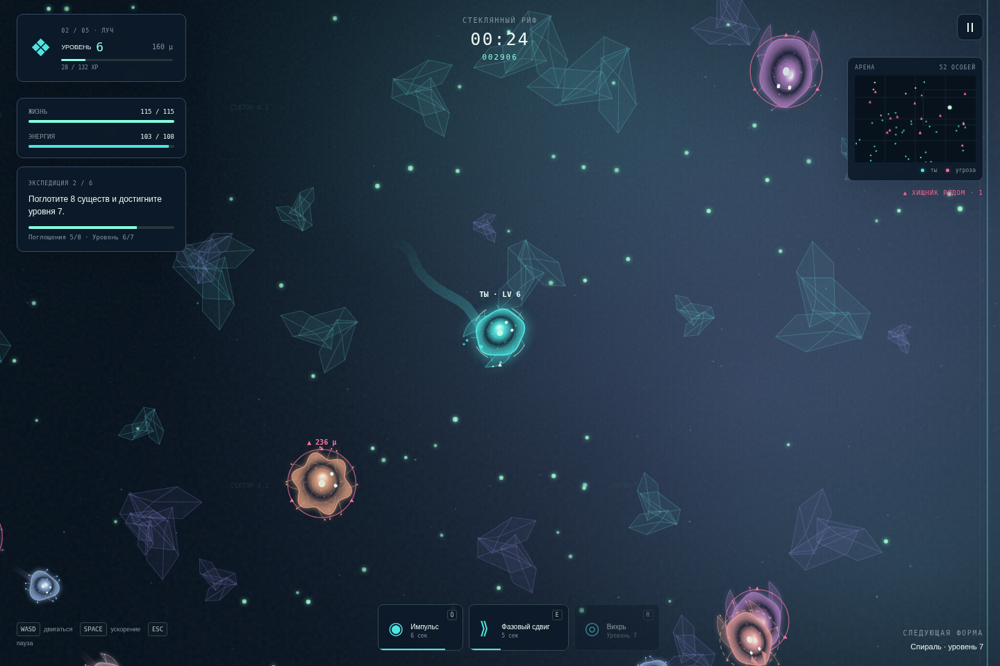
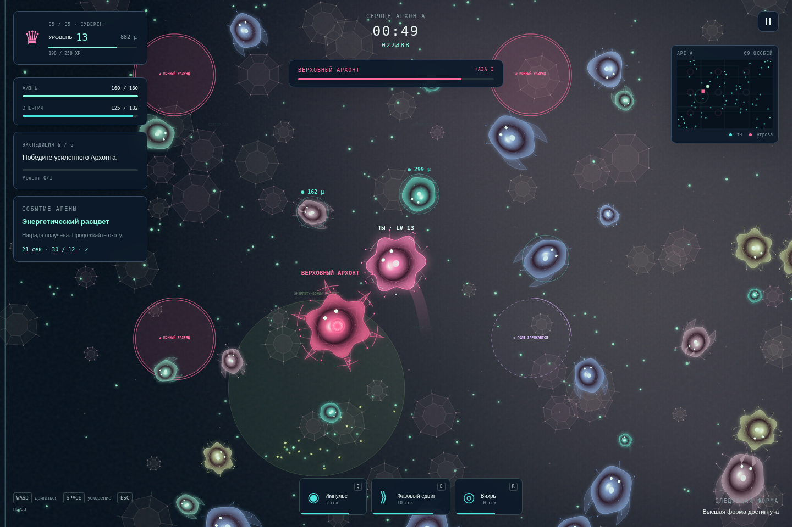

# NEON EVOLUTION · 2.1

Браузерная аркада о маленьком светящемся организме в живой неоновой экосистеме. Собирайте энергию, поглощайте добычу, выбирайте гены и становитесь главным хищником арены.

Теперь забеги объединены постоянным профилем: **кампания из 6 секторов, 50 уровней профиля, 6 лиг мастерства, кристаллы, 12 скинов, 15 призов пути экспедиции и ежедневные контракты**. Всё работает локально, без регистрации и платежей.

Версия 2.1 добавляет три цветовые атмосферы, собственный процедурный рельеф каждого мира, более выразительные организмы, чёткие маркеры угроз и полевой справочник.



Скачать все файлы: [ZIP с GitHub](https://github.com/NemelessGod/arcadsimrost/archive/refs/heads/main.zip). Распакуйте архив перед запуском.

## Запуск

Откройте **`index.html`** в современном браузере. Сборка, backend, загрузка ассетов, CDN и подключение к сети не нужны. Скрипты обычные, без ES-модулей, поэтому игра поддерживает `file://`.

Для разработки или если браузер запрещает локальные страницы:

```sh
cd /path/to/arcadsimrost
python3 -m http.server 8080 --bind 127.0.0.1
```

Откройте `http://127.0.0.1:8080`. На телефоне можно разместить эти же статические файлы на обычном веб-сервере. Python нужен только для необязательного сервера разработки.

## Правила

- Светящиеся частицы дают **массу, опыт, энергию и немного здоровья**. Золотые частицы ценнее.
- **Бирюзовое кольцо и ●** обозначают добычу: при массе на 18% больше вы поглощаете её касанием. **Жёлтый пунктир и ◆** — близкие по силе: помогают способности. **Розовое кольцо и ▲** — тяжелее и опаснее. Цвет тела относится к виду; цвет кольца меняется после вашего роста.
- Масса усиливает атаки, увеличивает размер и уменьшает базовую скорость. Размер меняется плавно; полученная масса действует сразу.
- При контакте с опасным существом вы получаете урон. После попадания действует 0,75 секунды защиты. Равных можно ослабить контактными атаками; панцирники получают на 40% меньше урона.
- Уничтожение слишком тяжёлого врага оставляет энергетические частицы; поглощение доступной добычи сразу восстанавливает жизнь и энергию.
- Каждый уровень приостанавливает арену и предлагает **3 разных улучшения**. Их можно складывать до указанного предела. При нескольких полученных уровнях выборы показываются последовательно.
- Одна жертва даёт максимум 100 базового XP и 70 базовой массы до действия генов. Очки учитывают полный размер жертвы. Это ограничивает лавинообразное развитие на поздних этапах.
- Задания дают опыт, массу, лечение и очки. Завершённые задачи отмечаются автоматически.
- Ускорение расходует энергию только во время движения. Истощение временно блокирует ускорение до восстановления 12 энергии. Отпустите ускорение или соберите еду.

### Эволюция и формы

| Уровень | Стадия | Что меняется |
| --- | --- | --- |
| 1 | Искра | Усики, светящееся ядро, импульс |
| 4 | Луч | Плавники, фазовый сдвиг |
| 7 | Спираль | Вращающиеся внутренние кольца, вихрь |
| 10 | Клык | Острые отростки, больше жизни и энергии |
| 13 | Суверен | Короноподобная оболочка, вызов Архонта |

Каждая эволюция увеличивает максимальную жизнь на 15, запас энергии на 8, даёт массу, лечит и восстанавливает энергию. Достигнутые формы сохраняются и доступны в меню. Любой забег начинается с первой стадии и 18 массы; выбранная стартовая форма даёт небольшой постоянный бонус: притяжение, скорость, урон, защита или рост. Боевой облик меняется со стадией развития.

### Способности

| Клавиша | Способность | Уровень | Энергия | Базовая перезарядка |
| --- | --- | --- | --- | --- |
| Q | Импульс: круговой урон и отталкивание | 1 | 18 | 7 с |
| E | Фазовый сдвиг: 2,2 с неуязвимости, скорость ×1,6 и однократный таран каждой цели | 4 | 24 | 13 с |
| R | Вихрь: 3,6 с притяжения еды/врагов и непрерывного урона | 7 | 32 | 18 с |

Перезарядка, сила, радиус и длительность усиливаются генами. Босс получает урон, но не отталкивается и не притягивается.

### 15 улучшений

Быстрые плавники (скорость), ассимиляция (масса), магнитные усики (радиус еды), энергокапсула (запас энергии), метаболизм (восстановление энергии), живой панцирь (снижение урона), хищный ген (урон), регенерация (лечение), быстрые синапсы (перезарядка), турбожгутик (ускорение и экономия), второе сердце (жизнь), нейропластичность (опыт), резонанс (импульс), фазовая память (сдвиг), гравитационное ядро (вихрь).

### Экосистема

| Существо | Поведение |
| --- | --- |
| Искатель | Ищет ближайшую еду и быстро убегает от угроз |
| Пастух | Медленно пасётся, растёт от еды и избегает хищников |
| Роевик | Держится группы; охотится с союзниками или на очень слабую цель |
| Ловец | Обнаруживает добычу издалека и ускоряется при преследовании |
| Панцирник | Охраняет свою территорию, атакует вошедшую добычу, устойчив к урону |
| Фантом | Медленно подкрадывается, затем бросается на близкую добычу |

AI учитывает массу игрока и соседних организмов. Существа также поглощают еду и охотятся друг на друга. В начале вокруг игрока есть безопасный участок с едой и небольшой добычей. Популяция восстанавливается, а масса новых противников растёт с длительностью забега.

### События и босс

Первое событие начинается через 40 секунд. События идут по циклу, длятся 30 секунд; после них есть 35 секунд передышки:

1. **Энергетический расцвет** — соберите 12 золотых частиц в отмеченной области.
2. **Великая миграция** — догоните и поглотите 3 странников.
3. **Ионная буря** — переживите 30 секунд, избегая розовых зон. Двухсекундное предупреждение позволяет уйти; фазовый сдвиг защищает от разрядов.

За завершение: 600 очков, 55 XP, масса, лечение и восстановление энергии. Мини-карта показывает события, угрозы и босса; стрелка у края направляет к событию или Архонту.

**Архонт** появляется через 4 минуты либо при достижении пятой стадии. Первая фаза чередует предупреждённые рывки и кольца снарядов. При 68% здоровья начинается вторая фаза с призывом помощников. Ниже 32% рывки ускоряются и появляются расширяющиеся ударные волны. Уклоняйтесь от розового коридора, используйте импульс и вихрь, проходите через угрозы в фазовом сдвиге. Победа даёт 5000 очков.

- **Выживание** — победа над Архонтом завершает забег.
- **Бесконечность** — после победы вы лечитесь, получаете рост и опыт; следующий Архонт приходит через 150 секунд. Забег заканчивается при смерти.

В игре 7 последовательных заданий, **13 достижений** и отдельные таблицы лучших 10 завершённых забегов для выживания, бесконечности и кампании. Выход в меню не записывает незавершённый забег.

## Кампания «Экспедиция»

Откройте карту экспедиции в главном меню. Победа открывает следующий сектор; все условия выбранной миссии нужно выполнить за один забег. Каждый сектор начинает рост заново, а формы, скины и постоянный профиль сохраняются. В первых пяти секторах босс не появляется.

| Сектор | Условия победы | Особенность | Первое прохождение |
| --- | --- | --- | --- |
| Колыбель | 40 частиц и уровень 4 | Более мягкая популяция, безопасный старт | 100 кристаллов |
| Стеклянный риф | 8 поглощений и уровень 7 | Больше золотой энергии | 140 кристаллов |
| Живые течения | Выжить 1:50 и поглотить 8 существ | Потоки сносят игрока и противников | 180 кристаллов |
| Ионные пустоши | 2 события и 300 массы | Постоянные поля с предупреждениями; ранняя буря | 230 кристаллов |
| Бездна | Уровень 13 и 18 поглощений | Ограниченная видимость и меньше еды на старте | 300 кристаллов |
| Сердце Архонта | Победить Верховного Архонта | Поля, усиленный босс, быстрые рывки и снаряды | 450 кристаллов |

Финальный босс приходит через 100 секунд или при достижении пятой стадии. Победа над ним завершает экспедицию и открывает достижение. Его орбитальная корона и ядро меняют оттенок с фазой; переходы сопровождаются заметными баннерами.

<details><summary>Скриншот боя с Верховным Архонтом</summary>



</details>

Можно получить до **3 звёзд**: за победу, за завершение с минимум половиной здоровья и за требуемый счёт. Порог счёта указан на карте; здоровье финальной миссии считается до победного лечения. Каждая новая звезда приносит ещё 25 кристаллов. Повторное прохождение даёт обычную награду забега; первый приз и уже заработанные звёзды не начисляются повторно. Перезапуск из паузы или результата повторяет тот же сектор; кнопка следующего сектора переводит дальше.

## Профиль, лиги и награды

Уровень профиля отличается от уровня существа: он сохраняется между забегами, до 50. После **победы или смерти** выдаются XP профиля, кристаллы и очки мастерства за время, еду, охоту, события и босса. Мгновенная смерть без активности не даёт этих наград: нужно провести 20 секунд, собрать 12 частиц, поглотить 2 существа или победить босса. Выход в меню и перезапуск незавершённого забега не начисляют наград. Экран результата показывает точную выдачу.

Лиги — **локальный личный прогресс**, записанный в этом браузере. Очки растут за завершённые забеги; поражение не отнимает их. Сетевого рейтинга игроков нет.

| Лига | Очки мастерства | Приз |
| --- | --- | --- |
| Спора | 0 | 40 кристаллов |
| Бронза | 200 | 90 кристаллов |
| Серебро | 650 | 160 кристаллов |
| Золото | 1400 | 250 кристаллов и скин Архонта |
| Платина | 2500 | 380 кристаллов |
| Неон | 4200 | 600 кристаллов |

Откройте «Лиги и призы», чтобы забрать доступные награды. На соседней вкладке расположен постоянный **путь экспедиции из 15 призов**: новый шаг каждые 240 суммарных XP профиля. Шаги 5, 10 и 15 открывают эксклюзивные скины. Каждый приз выдаётся один раз; путь не требует покупки и не истекает.

### Коллекция скинов

В магазине 12 процедурных обликов с собственными цветами и узорами: Живая искра, Солнечный ген, Ледяной осколок, Орхидея, Тлеющее ядро, Белый шум, Токсичный цветок, Призма, Нулевая материя, Полярное сияние, Туманность и Ген Архонта.

Живая искра открыта сразу; семь обликов покупаются за заработанные кристаллы; три выдаются за путь и один за золотую лигу. Карточка показывает цену или условие открытия. Покупка сразу применяет скин, а принадлежащие скины можно переключать бесплатно. Облик виден в меню и в забеге, меняется вместе с эволюцией. **Скины не меняют боевые параметры**; бонус стартовой формы выбирается отдельно в прежней коллекции форм.

### Ежедневные контракты

Каждый день доступны 3 разных задания из набора: еда, поглощения, способности, события, боссы и время выживания. Они суммируют результаты **завершённых** забегов во всех режимах. Заберите кристаллы кнопкой в карточке после выполнения. Контракты обновляются в местную полночь по дате устройства; незабранные суточные призы не переносятся. Это локальная система, без серверной проверки часов.

### Перенос прогресса

Нажмите уровень профиля в шапке меню, затем «Скачать сохранение». Полученный JSON содержит весь профиль и настройки. На другом устройстве откройте профиль и выберите «Загрузить сохранение». Импорт заменяет текущие данные, поэтому сначала экспортируйте их. Неправильный JSON и файлы больше 200 КБ отклоняются без потери текущего профиля; проверенные настройки применяются сразу.

## Управление

| Действие | ПК | Телефон |
| --- | --- | --- |
| Движение | WASD / стрелки | Левый джойстик |
| Ускорение | Удерживать Space | Удерживать BOOST |
| Способности | Q / E / R или кнопки | Три кнопки справа |
| Пауза | Escape / кнопка сверху | Кнопка сверху |
| Выбор улучшения | 1 / 2 / 3 или кнопка | Карточка улучшения |

Сенсорное управление поддерживает одновременное движение, ускорение и нажатие способностей. Оно включается автоматически на сенсорных экранах и узких окнах; можно включить вручную в настройках. Портретная и альбомная ориентации имеют разные раскладки. При скрытии вкладки или потере фокуса одиночный забег автоматически приостанавливается.

Обучение запускает обычный забег с последовательными подсказками и краткой начальной защитой. Настройки доступны и из паузы.

## Цвета, графика и удобство

В настройках есть **Биолюминесценция**, **Ультрафиолет** и **Солнечный шторм**. Палитра применяется к интерфейсу и атмосфере Canvas сразу; каждый сектор сохраняет своё оформление: растения Колыбели, кристаллы Рифа, линии течений, ионные структуры, тёмные образования Бездны и геометрия сердца Архонта. Фон получает мягкий свет, глубину и параллакс, организмы — внутренние структуры, различающиеся силуэты и затухающие следы. Внешних игровых ассетов нет.

Интенсивность свечения регулируется от 0 до 100%. «Чёткие индикаторы угроз» усиливают кольца и контраст текста. «Фоновая анимация» отключает декоративное движение и встряску камеры; положение снарядов, действие способностей и предупреждения продолжают отражать реальную симуляцию. Для нового профиля учитывается системная настройка уменьшения движения. Все эти настройки сохраняются и входят в резервную копию.

Цвета силы и геометрические маркеры одинаковы во всех атмосферах. Игрок постоянно отмечен белыми дугами, стрелкой и подписью **«ТЫ · LV»**. Подписи сохраняют читаемый размер при удалении камеры. Мини-карта показывает хищников треугольниками; ионные поля имеют пунктирное предупреждение и кольцо заряда. Фоновый рельеф декоративный и не мешает движению.

Откройте **«Справочник»** в меню или из паузы: там представлены все шесть видов с процедурными иллюстрациями, правила поведения, советы и параметры трёх способностей. На экране поражения указаны источник последнего удара и соответствующий совет. Переходы эволюций и фаз босса отмечаются отдельными баннерами. При переходе между диалогами прокрутка возвращается к началу; незавершённый забег и отсутствие наград при его перезапуске поясняются в паузе.

## Звук, производительность и сохранения

Все эффекты синтезируются через Web Audio после первого действия пользователя: сбор, поглощение, эволюция, три способности, урон и победа. Есть громкость и выключение звука. Без поддержки Web Audio игра работает без звука.

Три уровня качества меняют плотность пикселей, свечение и количество частиц. Можно отключить встряску камеры. Симуляция использует фиксированный шаг 1/60 секунды и `requestAnimationFrame`; после длинной задержки выполняется не больше 6 шагов за кадр. Поиск еды, угроз и столкновений использует пространственную сетку с ячейкой 140.

Декоративный рельеф ограничен 120/72/32 элементами по качеству; вне камеры он не рисуется. Текстуры фона рассчитываются один раз и хранятся в ограниченном кэше из максимум трёх Canvas размером 512×512 (256×256 на низком качестве). Низкое качество также убирает фоновые звёзды и сокращает детализацию организмов. Процедурная графика использует отдельные детерминированные значения, чтобы оформление не влияло на случайность игровой симуляции.

Лимиты: 420 частиц еды, 84 обычных врага, 360/180/65 визуальных частиц, 72 снаряда, 6 ударных волн и 28 колец эффектов. Максимальный уровень — 50, масса — 5000; бесконечный режим продолжает начислять очки после пределов развития.

Ключ localStorage: `neon-evolution.save`, версия **3**. Сохраняются настройки, формы, выбранный ген, достижения, рекорды, профиль, кристаллы, мастерство, звёзды секторов, покупки и полученные призы/контракты. Данные версий 1 и 2 проверяются и переносятся автоматически; сохраняются прежние достижения и рекорды, а за прошлые завершённые забеги начисляется небольшой однократный стартовый подарок. Повреждённый JSON, неизвестная версия и неправильные поля восстанавливаются безопасно. Если хранилище запрещено или переполнено, игра продолжает работу с прогрессом в памяти и сообщает об этом. Незавершённый забег не сохраняется.

Сохранения относятся к браузеру и адресу страницы: `file://` и разные HTTP-адреса могут иметь отдельные хранилища. Для стабильного прогресса открывайте игру одним способом.

## Файлы

```text
index.html             интерфейс, подключение обычных скриптов
styles.css             неоновый UI и адаптивные раскладки
js/config.js           контент, параметры, формы и гены
js/storage.js          проверка, восстановление и запись прогресса
js/progression.js      профиль, экономика, звёзды, лиги, призы и контракты
js/visuals.js          палитры, индикаторы, справочник и кэш процедурного фона
js/audio.js            процедурный Web Audio
js/grid.js             пространственная сетка
js/entities.js         фабрики игрока, еды, противников и босса
js/ai.js               поведение экосистемы и фазы босса
js/collisions.js       поглощение, урон, притяжение и снаряды
js/input.js            клавиатура, Pointer Events, мультитач и автопауза
js/renderer.js         Canvas 2D, камера, эффекты и мини-карта
js/game.js             симуляция, развитие, задания, события и режимы
js/ui.js               меню, HUD, настройки, обучение и результаты
js/hub.js              карта, профиль, скины, призы и резервные копии
js/boot.js             единый цикл requestAnimationFrame
tests/browser.test.cjs необязательные браузерные проверки
tests/progression.test.cjs проверки новой кампании, экономики и сохранений
tests/campaign-soak.cjs полный игровой прогон кампании автоматическим игроком
tests/visuals.test.cjs проверка графики, настроек, справочника и удобства
docs/screenshots/      скриншоты игрового прогона для README; не используются игрой
```

## Проверки для разработчика

Для игры зависимости не нужны. Только для автоматических тестов установите Node.js и Playwright в отдельную папку:

```sh
npm install --prefix /tmp/neon-test-tools playwright
NODE_PATH=/tmp/neon-test-tools/node_modules node /tmp/neon-test-tools/node_modules/playwright/cli.js install chromium
```

Запустите локальный сервер по инструкции выше, затем тесты, указав путь к установленному Chromium:

```sh
NODE_PATH=/tmp/neon-test-tools/node_modules CHROME_BIN=/path/to/chromium node tests/browser.test.cjs
NODE_PATH=/tmp/neon-test-tools/node_modules CHROME_BIN=/path/to/chromium node tests/progression.test.cjs
NODE_PATH=/tmp/neon-test-tools/node_modules CHROME_BIN=/path/to/chromium node tests/visuals.test.cjs
NODE_PATH=/tmp/neon-test-tools/node_modules CHROME_BIN=/path/to/chromium node tests/campaign-soak.cjs
```

`NE_TEST_URL` позволяет выбрать адрес сервера. Набор использует настоящий headless Chromium и управляемые игровые сценарии, чтобы проверить стадии, способности, события и босса без ожидания четырёх минут. Сенсорные проверки используют нативные события мультитача через Chromium DevTools Protocol. Они проверяют **браузерную эмуляцию**, а не реальные телефоны.

Для сохранения скриншотов Рифа и Архонта во время настоящего автоматического прохождения задайте `NE_TEST_CAPTURE=/path/to/screenshots` при запуске `tests/campaign-soak.cjs`. Это необязательный режим проверки; файлы не нужны для игры.

Результаты выполненных прогонов и ограничения среды описаны в [VALIDATION.md](VALIDATION.md). Основные и новые проверки дополняет полный прогон кампании с обычными способностями, улучшениями, едой и охотой; его автоматический игрок не назначает искусственно здоровье, опыт, массу или счётчики миссий. Это проверка достижимости целей, а не оценка сложности для человека.

Игра рассчитана на одного игрока. Нет backend, мультиплеера и облачной синхронизации. Локальные лиги, валюта и часы не защищены от редактирования владельцем устройства. Для переноса прогресса используйте резервную копию. Баланс можно менять в `js/config.js` и `js/game.js`; длительные забеги и производительность на физических мобильных устройствах требуют отдельного игрового тестирования.
